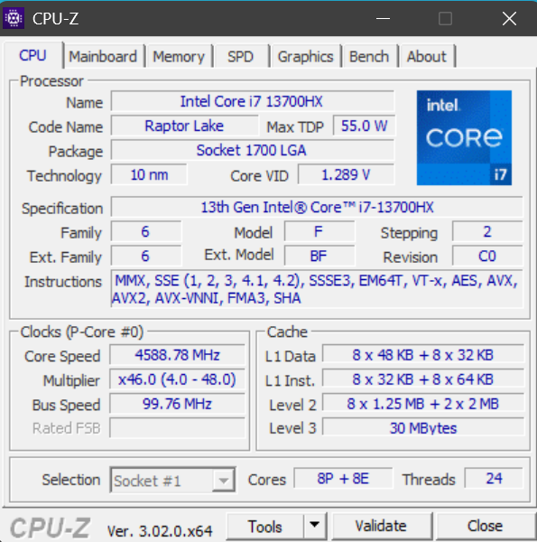
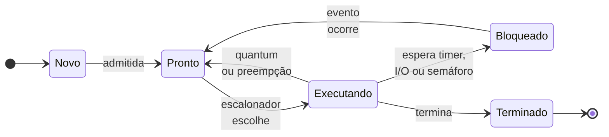
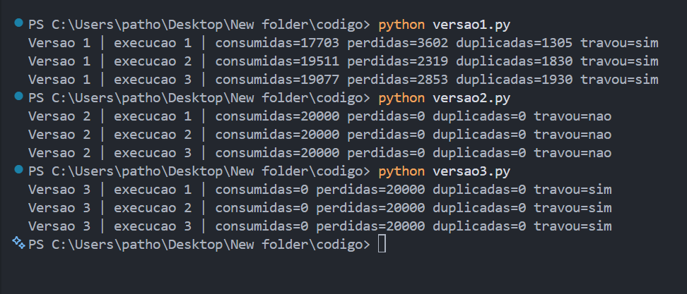
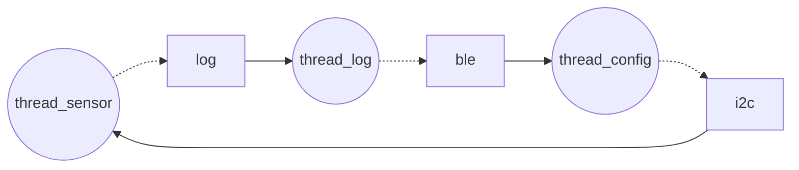

**Nome completo:** Lucas Cofcewicz Faria

# Ponderada CC08: do pipeline ao deadlock
### Lucas Cofcewicz Faria

## Parâmetros Indíviduais
D1: Lucas = 5 -> **D1 = 5**

D2: Lucas Cofcewicz Faria = 5 + 9 + 5 = 19 -> **D2 = 9**

N: 3 + (D2 mod 5) = 3 + (9 mod 5) = 3 + 4 -> **N = 7**

m: 3% + 0.5% × D1 = 3% + 0.5% × 5 = **5.5%**

# Parte A: o problema técnico

## A1. Arquitetura e memória: qual processador vai na pulseira?

### A1.1 Plataforma H (48 MHz, CPI 1.5)

Instruções por amostra (IC)
```
100000 + 20000 × D2
100000 + 20000 × 9 = 280000
```

Tempo de CPU
```
Tempo = (Instruções * CPI) / Clock

Usando os dados da tabela mais o IC que calculamos

Tempo = (280000 * 1.5) / (48 * 10^6) = 8.75*10^-3 ou 8.75 ms
```

Resultado = 8.75 ms o qual é maior que 5 ms, provando que o sistema H não é valido.

### A1.2 Plataforma V (1.2 GHz, cache L1)

```
AMAT = t_acerto + m × penalidade
     = 1 + 0.055 × 120
     = 7.6 ciclos

CPI efetivo = 1.0 + (acessos/instr × m × penalidade)
            = 1.0 + (1.3 × 0.055 × 120)
            = 1.0 + 8.58
            = 9.58

Ciclos = IC × CPI efetivo = 280000 × 9.58 = 2682400 ciclos
Tempo médio por amostra = 2682400 / (1.2 × 10^9) = 2.235 × 10^-3 s = 2.235 ms

Pior caso = tempo médio + atraso do SO
          = 2.235 ms + 3 ms = 5.235 ms
```

Resultado: A plataforma V não atende o requirimento. No caso médio atende (2.235 ms < 5 ms), porém no pior caso não atende (5.235 ms > 5 ms) estourando o limite.

### A1.3 Plataforma H com acelerador DSP (Lei de Amdahl)

```
Fração acelerada (f) = 0.6     
Ganho da parte (s) = 5

Speedup = 1 / ((1 − f) + f / s)
        = 1 / (0.4 + 0.6 / 5)
        = 1 / 0.52
        = 1.923

Novo tempo = tempo H / speedup = 8.75 ms / 1.923 = 4.55 ms
```

Resultado: agora a plataform atende o requerimento, tomando 4.55 ms, 0.45 ms abaixo do necessário.

### A1.4 Por que V precisa de cache e H não? (até 5 linhas)

A V usa Von Neumann: instruções e dados ficam na mesma DRAM externa e passam pelo mesmo barramento, e a CPU espera a memória (gargalo de Von Neumann). Uma falta na DRAM custa 120 ciclos, então sem cache todo acesso pagaria esse preço e o tempo estouraria. O cache L1 guarda o que é reutilizado e responde em 1 ciclo, escondendo a latência da DRAM.

A H é Harvard: busca a instrução e acessa o dado ao mesmo tempo, por barramentos separados. Além disso a SRAM interna da H responde em 1 ciclo, então não há latência para esconder e o cache não ajudaria.

### A1.5 Evidência da minha máquina



Utilizando CPUZ, podemos observar que o meu computador utiliza um cache L1 separado em 2 categorias, Data e Instruções. Isso confirma que o meu computador usa uma arquitetura baseada na de Harvard para o processor, já que sua memória não é unificada.

## A2. Pipeline: o loop do filtro

### A2.1 Dependências RAW

| Instrução que depende | Depende de | Registrador |
|---|---|---|
| 2 `add` | 1 `lw` | x5 | 
| 4 `sub` | 2 `add` | x6 | 
| 4 `sub` | 3 `lw` | x7 | 
| 5 `sw` | 4 `sub` | x6 |

### A2.2 Sem forwarding

Legenda: IF, ID, EX, MEM, WB, `--` = instrução parada neste ciclo (por dependência ou por esperar quem está na frente).

O registrador é escrito na 1ª metade do ciclo e lido na 2ª, então o `ID` do dependente pode cair no mesmo ciclo do `WB` do produtor.

| Instr. | C1 | C2 | C3 | C4 | C5 | C6 | C7 | C8 | C9 | C10 | C11 | C12 | C13 | C14 | C15 | C16 | C17 |
|---|---|---|---|---|---|---|---|---|---|---|---|---|---|---|---|---|---|
| 1 lw    | IF | ID | EX | MEM | WB |  |  |  |  |  |  |  |  |  |  |  |  |
| 2 add   |  | IF | -- | -- | ID | EX | MEM | WB |  |  |  |  |  |  |  |  |  |
| 3 lw    |  |  | IF | -- | -- | ID | EX | MEM | WB |  |  |  |  |  |  |  |  |
| 4 sub   |  |  |  |  |  | IF | -- | -- | ID | EX | MEM | WB |  |  |  |  |  |
| 5 sw    |  |  |  |  |  |  | IF | -- | -- | -- | -- | ID | EX | MEM | WB |  |  |
| 6 addi  |  |  |  |  |  |  |  |  |  | IF | -- | -- | ID | EX | MEM | WB |  |
| 7 addi  |  |  |  |  |  |  |  |  |  |  |  |  | IF | ID | EX | MEM | WB |

```
Total = 5 + (instruções − 1) + bolhas = 5 + 6 + 6 = 17 ciclos

Bolhas por dependência: 2 (2 add esperando x5) + 2 (4 sub esperando x6/x7) + 2 (5 sw esperando x6) = 6
(os demais `--` da tabela são instruções esperando na fila atrás delas e não somam ciclos novos)
```

### A2.3 Com forwarding

| Instr. | C1 | C2 | C3 | C4 | C5 | C6 | C7 | C8 | C9 | C10 | C11 | C12 | C13 |
|---|---|---|---|---|---|---|---|---|---|---|---|---|---|
| 1 lw    | IF | ID | EX | MEM | WB |  |  |  |  |  |  |  |  |
| 2 add   |  | IF | ID | -- | EX | MEM | WB |  |  |  |  |  |  |
| 3 lw    |  |  | IF | -- | ID | EX | MEM | WB |  |  |  |  |  |
| 4 sub   |  |  |  |  | IF | ID | -- | EX | MEM | WB |  |  |  |
| 5 sw    |  |  |  |  |  | IF | -- | ID | EX | MEM | WB |  |  |
| 6 addi  |  |  |  |  |  |  |  | IF | ID | EX | MEM | WB |  |
| 7 addi  |  |  |  |  |  |  |  |  | IF | ID | EX | MEM | WB |

```
Total = 5 + 6 + 2 = 13 ciclos
```

**Dependência que ainda gera bolha:** load-use: `lw x5` → `add` (x5) e `lw x7` → `sub` (x7), uma bolha em cada.
**Por quê:** o `lw` só tem o dado pronto no fim do estágio MEM, e o `add`/`sub` seguinte precisa dele no início do EX, um ciclo antes. O forwarding não consegue mandar um dado para trás no tempo, então sobra 1 bolha por load-use.

### A2.4 Reordenação sem bolhas

```
1 lw   x5, 0(x10)
2 lw   x7, 0(x11)
3 add  x6, x6, x5
4 sub  x6, x6, x7
5 sw   x6, 0(x12)
6 addi x10, x10, 4
7 addi x11, x11, 4
```
subindo o `lw x7` para antes do add. Ele lê `0(x11)`, que o add não escreve nem lê, e escreve x7, que o add não usa. Add antes de `sub` (a soma continua `soma + nova − antiga`) e os addi depois dos `lw`/`sw` que usam x10 e x11 foram mantidos já que não afetavam o fluxo.

| Instr. | C1 | C2 | C3 | C4 | C5 | C6 | C7 | C8 | C9 | C10 | C11 |
|---|---|---|---|---|---|---|---|---|---|---|---|
| 1 lw x5 | IF | ID | EX | MEM | WB |  |  |  |  |  |  |
| 2 lw x7 |  | IF | ID | EX | MEM | WB |  |  |  |  |  |
| 3 add |  |  | IF | ID | EX | MEM | WB |  |  |  |  |
| 4 sub |  |  |  | IF | ID | EX | MEM | WB |  |  |  |
| 5 sw |  |  |  |  | IF | ID | EX | MEM | WB |  |  |
| 6 addi x10 |  |  |  |  |  | IF | ID | EX | MEM | WB |  |
| 7 addi x11 |  |  |  |  |  |  | IF | ID | EX | MEM | WB |

```
Novo total = 5 + 6 + 0 = 11 ciclos (2 a menos que com forwarding sem reordenar)
```

## A3. Processos e threads: como organizar o software

### A3.1 Organização proposta

| Tarefa | Thread ou processo? | Processo nº |
|---|---|---|
| Ler o sensor | thread | 1 (núcleo) |
| Processar a amostra | thread | 1 (núcleo) |
| Acionar o motor | thread | 1 (núcleo) |
| BLE (log + comandos) | processo separado | 2 |

**Justificativa:**
- **Compartilhamento de memória:** sensor, processamento e motor trocam amostras o tempo todo; como threads do mesmo processo, usam o mesmo buffer direto, sem copiar nem usar IPC.
- **Custo de criação e troca de contexto:** thread é mais barata de criar e trocar (mesmo espaço de endereçamento, sem trocar tabela de páginas), o que ajuda nos 5 ms. O BLE não está no caminho crítico, então pode pagar o custo de um processo.
- **Isolamento de falhas:** o BLE conversa com o mundo de fora e é o mais propenso a travar ou ser atacado. Em processo próprio, se ele cair o núcleo continua lendo o sensor e vibrando.

### A3.2 Se alguém explorar uma falha no BLE

**Como thread:** o invasor roda dentro do processo do núcleo, vê a memória das amostras e do motor, e pode corrompê-las ou derrubar o processo inteiro, inclusive a vibração.

**Como processo separado:** a falha fica presa ao espaço de endereçamento do BLE (isolado pela MMU); ele só fala com o núcleo por IPC, que pode ser validado, e pode rodar com menos privilégios. O núcleo segue funcionando.

### A3.3 Diagrama de estados



Estado em que a thread do sensor passa mais tempo: Bloqueado
Por quê: ela lê uma amostra a cada 10 ms e o trabalho de cada leitura é de poucos ms, então a maior parte do tempo ela espera o próximo tick do timer ou o sensor responder.

## A4. Código com semáforos: o buffer entre sensor e motor

- Linguagem: Feito em python
- Buffer circular de **N = 7** posições, 20000 amostras por execução
- Código em [`codigo/`](codigo/): `versao1.py`, `versao2.py`, `versao3.py`

### Resultados (3 execuções por versão)

| Versão | Execução | Consumidas | Perdidas | Duplicadas | Travou? |
|---|---|---|---|---|---|
| 1 (sem sincronização) | 1 | 20000 | 3933 | 3933 | não |
| 1 (sem sincronização) | 2 | 20000 | 2600 | 2600 | não |
| 1 (sem sincronização) | 3 | 17853 | 3700 | 1553 | sim |
| 2 (semáforos) | 1 | 20000 | 0 | 0 | não |
| 2 (semáforos) | 2 | 20000 | 0 | 0 | não |
| 2 (semáforos) | 3 | 20000 | 0 | 0 | não |
| 3 (ordem trocada) | 1 | 0 | 20000 | 0 | sim |
| 3 (ordem trocada) | 2 | 0 | 20000 | 0 | sim |
| 3 (ordem trocada) | 3 | 0 | 20000 | 0 | sim |

### Prints



### Análise

**Região crítica da versão 1:**
```
# produtor
buf[estado["entrada"]] = i
estado["entrada"] = (estado["entrada"] + 1) % N
tmp = estado["ocupadas"]      # le o contador
time.sleep(0)                 # interrupcao no pior momento
estado["ocupadas"] = tmp + 1  # escreve

# consumidor
recebidas.append(buf[estado["saida"]])
estado["saida"] = (estado["saida"] + 1) % N
tmp = estado["ocupadas"]
time.sleep(0)
estado["ocupadas"] = tmp - 1
```
**Por que perde ou duplica amostras:** `ocupadas = ocupadas ± 1` não é atômico: são três passos (ler, calcular, escrever). Com o `sleep(0)` no meio, as threads se intercalam e uma escrita apaga a atualização da outra. Se o contador fica menor que o real, o produtor sobrescreve amostras não lidas (perdidas); se fica maior, o consumidor lê posição já lida ou vazia (duplicadas) e o contador pode dessincronizar até travar.

**O que cada semáforo garante na versão 2:**

| Semáforo | Valor inicial | Garante que |
|---|---|---|
| `vazio` | N | o produtor só grava se houver posição livre (não sobrescreve amostra não lida) |
| `cheio` | 0 | o consumidor só lê se houver amostra disponível (não lê posição vazia nem repete) |
| `mutex` | 1 | só uma thread por vez mexe nos índices e no buffer (exclusão mútua na região crítica) |

**O que aconteceu na versão 3 e por quê:** deadlock. Quando o buffer enche (`vazio` = 0), o produtor já pegou o `mutex` e dorme em `wait(vazio)` segurando-o. O consumidor precisa do `mutex` para retirar um item e só depois faria `signal(vazio)`, então fica esperando o `mutex`. Cada um espera o que o outro tem (posse e espera + espera circular), ninguém avança e o consumidor fica 1 s sem receber nada, o que é registrado como travamento.

## A5. Deadlock: a pulseira congelou

### A5.1 Sequência que leva ao deadlock

| Passo | Thread | Operação | Estado |
|---|---|---|---|
| 1 | thread_sensor | `P(i2c)` | obtém i2c |
| 2 | thread_log | `P(log)` | obtém log |
| 3 | thread_config | `P(ble)` | obtém ble |
| 4 | thread_sensor | `P(log)` | bloqueada (log está com thread_log) |
| 5 | thread_log | `P(ble)` | bloqueada (ble está com thread_config) |
| 6 | thread_config | `P(i2c)` | bloqueada (i2c está com thread_sensor): **deadlock** |

**Grafo de alocação de recursos nesse instante** (recurso → thread = alocado; thread → recurso = esperando):



### A5.2 As quatro condições de Coffman

| Condição | Como aparece neste código |
|---|---|
| Exclusão mútua | cada recurso (i2c, log, ble) é um semáforo binário: só uma thread por vez o usa |
| Posse e espera | cada thread segura um recurso (`P`) enquanto pede o próximo, sem soltar o primeiro |
| Sem preempção | o recurso só é liberado pela própria thread, com `V`; ninguém o tira à força |
| Espera circular | sensor espera log → log espera ble → config espera i2c → sensor (ciclo fechado) |

### A5.3 Duas correções de tipos diferentes

| | Correção 1: ordem global de recursos (tipo: prevenção) | Correção 2: `P` com timeout + watchdog (tipo: detecção e recuperação) |
|---|---|---|
| O que muda no código | Todas as threads pegam sempre na ordem i2c → log → ble. Só a `thread_config` muda: `P(i2c)` antes de `P(ble)`. | `P` com timeout (ex.: 50 ms). Se estourar, a thread faz `V` do que já tem e tenta de novo. Um watchdog reinicia o sistema se o laço do sensor não responder em um tempo limite. |
| Qual condição quebra / como detecta | Quebra a espera circular: não existe ciclo se todos pedem em ordem crescente. | Detecta pelo timeout/watchdog e quebra posse e espera ao forçar a liberação do que a thread segura. |
| O que muda para quem usa a pulseira | Nada visível; um comando de configuração pode demorar um pouco mais para ser aplicado. A pulseira nunca congela. | Um log ou comando pode ser repetido ou perdido; no pior caso a pulseira reinicia sozinha em instantes, sem vibrar nesse intervalo, mas sem precisar ser desligada na mão. |

# Parte B: a decisão do CTO

### Dilema 1: lançar com o bug ou perder o edital?

Em um caso como esse, é essencial analisarmos a situação com cuidado e tato, pois existe um conflito ético entre diferentes responsabilidades. Por um lado, temos a responsabilidade de entregar aos usuários um produto confiável, seguro e que corresponda às expectativas de qualidade. Por outro, temos os interesses da empresa, dos investidores e dos clientes, que esperam resultados em um prazo determinado. Adiar o lançamento por mais dois meses pode comprometer a confiança dos investidores, prejudicar a relação com os clientes e aumentar o risco de defunding. Entretanto, lançar um produto com um erro crítico conhecido também levanta uma questão ética: até que ponto é aceitável transferir aos usuários os riscos de uma falha que a própria empresa já identificou?

Na minha visão, acredito que seja válido lançar o produto mesmo com o bug. Abrimos mão de entregar uma solução tecnicamente perfeita, mas a perda de 4 segundos de uso em uma janela de 10.000 horas representa um impacto extremamente pequeno para o usuário. Nesse contexto, considero que o custo de corrigir o problema pode ser desproporcional ao benefício gerado. Se a implementação da correção for complexa, exigir dois meses de trabalho e ainda demandar novos testes da solução, estaremos comprometendo recursos e oportunidades por um erro que praticamente não afeta a experiência do usuário. Contudo, essa decisão exige transparência: não seria eticamente correto ocultar dos clientes e das partes interessadas a existência de uma falha já conhecida.

Uma situação que me faria mudar de ideia seria se o erro impedisse completamente o funcionamento da solução após 10.000 horas de uso, especialmente se um simples reinício não fosse suficiente para resolvê-lo, tornando necessária a assistência técnica. Nesse cenário, o produto teria, na prática, um limite de vida útil que poderia não estar claro para o consumidor. A decisão de lançá-lo nessas condições deixaria de representar apenas um pequeno comprometimento técnico e passaria a significar a transferência de um problema significativo para os usuários. Além de prejudicá-los, isso também geraria consequências para a empresa, que poderia ter de realizar reparos em massa e sofrer danos à sua reputação por comercializar um produto com um defeito conhecido. Portanto, meu posicionamento depende de uma avaliação proporcional dos riscos: os interesses comerciais podem justificar a aceitação de pequenas imperfeições, mas não devem se sobrepor à segurança, à transparência e aos direitos dos usuários.
